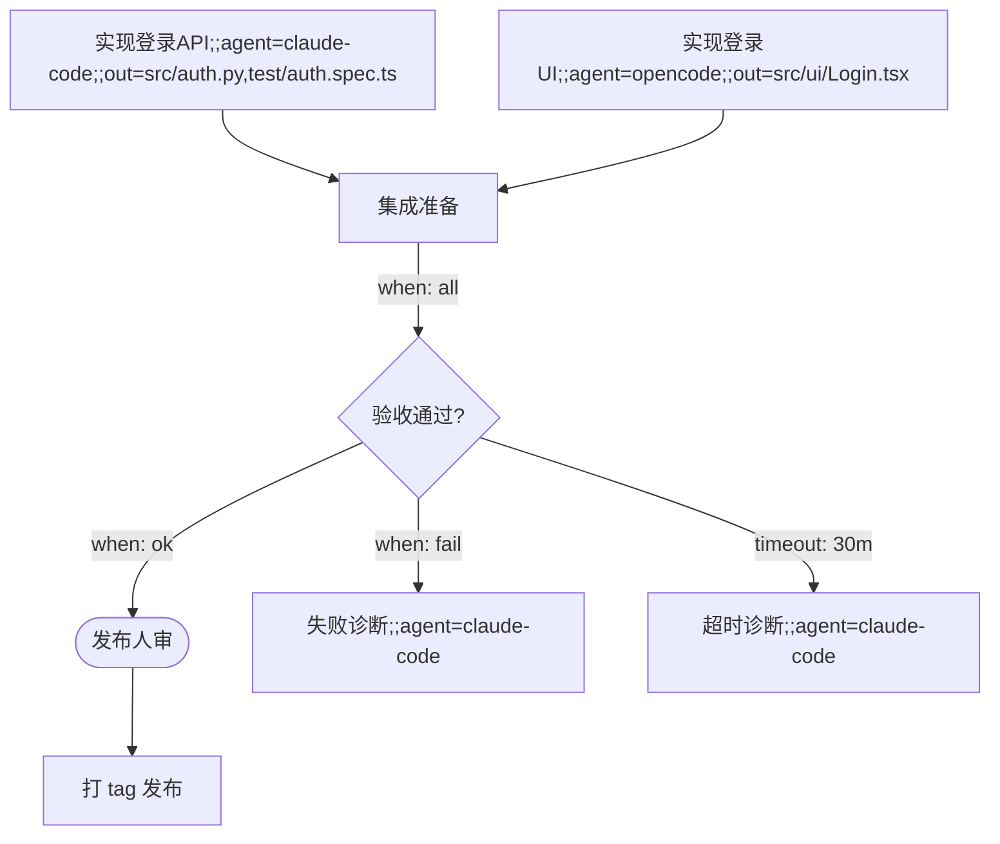

# FlowRun 设计文档

> 工作名 FlowRun（可改）。一句话定位：**用通识语言（Mermaid 流程图 + todo）定义流程、由确定性内核驱动、可零改码调度任意 agent CLI 的多 Agent 编排运行时**。
> spec-kit 回答"该做什么"；FlowRun 回答"**谁在做、做到哪、凭什么信**"。
>
> 版本：v2（2026-10-15，基于两轮架构推演 + 六线调研证据）

---

## 1. 需求解析

用户原始需求三条，逐条解析为硬性约束：

| 原话 | 解析 | 硬性约束 |
|---|---|---|
| "适配任意 agent 工具而不需要修改一行代码" | 目标 agent 零改码接入 | 适配只允许三种面：文件系统约定、ACP、headless CLI。**禁止**依赖任何 agent 的内部 API（DeepSeek-Bot 的"零侵入寄生"恰恰证明绑宿主内部 API 最脆） |
| "该工具也不需要有代码" | 有两种解释，需决议（见 §2.1） | 用户产物必须是纯通识语言文件；判定门槛：**任何要求用户写 JSON/YAML/脚本的设计都算越界，砍掉** |
| "使用通识语言（流程图，todo，交互图等共识）来定义和管理流程" | 流程图的执行语义由本工具承载 | Mermaid flowchart 为 source of truth；todo 为执行状态投影；交互图（sequenceDiagram）只做人读协议文档（调研证实其无可执行先例，是消息时序视角） |

### 2.1 "零代码"的决议

- **解释 (a)**：用户零代码——产物只有通识语言文件，运行时内核是隐藏的发行物。
- **解释 (b)**：纯 markdown 驱动现有 agent 自当编排器（BMAD 路线）。

**决议：取。** BMAD 的 Jinja2 workflow 模板（`` / `{{ halt() }}`）证明纯 markdown 可以表达条件与暂停，但它自我声明 "Sequential execution only"，且**没有运行时状态、没有断点续跑、没有并行调度、没有预算闸门**——这四项正是多 Agent 协作的刚需，也正是本工具的存在理由。解释 留作退化形态（不装内核时图仍可被人/agent 当说明书读）。

### 2.2 必须具备而竞品做不到的（护城河假设）

spec-kit（141k★）= 一次性单向流水线（spec→plan→tasks，跑完即止，`[P]` 并行只是散文提示）；BMAD = 顺序执行 only；n8n/Dify/Langflow = 可视化画布编译成引擎 DSL，流程语义由引擎内置节点承载，**不能编排外部黑盒 CLI agent**。

FlowRun 的钉子：**多 Agent 运行时**——图跨会话存活、条件边、fork/join 并行、断点续跑、预算与人审闸门。护城河不在 Mermaid 解析（薄，人人可做），而在：执行内核的闸门与边校验（把不可信模型约束成可托付流程，踩坑密度最高）、ledger 协议、"图跨会话存活"的语义。

---

## 2. 调研结论摘要（证据链）

### 2.1 DSH 生态 6 个同类项目的路线教训

| 项目 | 路线 | 借鉴点 |
|---|---|---|
| Fei2411/DeepSeek-Bot | 零侵入寄生：1 Bot=1 root Session，单 JSON 状态，群聊=中继+隐藏成员 Session | 三道闸防失控（hop≤6、无人值守消息预算 40、不信任模型手工合成调用）；前缀缓存纪律；弱点=平台内部 API 耦合最脆 |
| dushaobindoudou/dsh-bots | 编排在外、投影进来（薄桥到外部引擎） | 发现自愈（探活+原子写回）；零侵入桥接的姿态 |
| wowyuarm/dsh-agent-team | 事实在内、模型来取 | **append-only ledger**（全局 sequence+prev-link+幂等），session 可归档而身份/Claim/记忆不动 |
| Tikzen/dsh-agent-arena | 群聊 + LLM 仲裁发言权 | 意图判定+管理员复核的双层仲裁（本工具只取其"判定器输出结构化 verdict"思想） |
| Socialist-Sister/dsh-collaboration | 主 Agent 按需雇佣，星型拓扑 | 名册模板→实例克隆；per-identity 工具裁剪 |
| zzzpyyy/dsh-bot | 持久群聊，@mention 路由 | attempt/cursor/receipt 三重确认，失败停在可审计位置 |

### 2.2 外部先行方案（star 数均现场查证，2026-10）

- **github/spec-kit**（141k★）：一份命令模板 + `__SPECKIT_COMMAND_*__` 占位符 + 每 CLI 一个薄适配子类（只声明 config 与 build_exec_args，shutil.which 探测）——**本工具适配器直接照抄此模式**。应抛弃：bash/ps/py 三方言脚本镜像。
- **BMAD-METHOD**（54k★）：story frontmatter = DAG 数据化（`parent / after:[id] / covers:[R2]`）+ `<frozen-after-approval>` 冻结块；应抛弃"角色人格即配置"（把控制流埋进自然语言）。
- **vibe-kanban**（28k★）：**双信号退出监视器**（select! 竞速 OS 退出码 vs 语义完成信号，解决"agent 跑完不退出"）；零改码契约 = issue 标题+描述纯 prompt + 每 issue 独立 git worktree，判定靠 diff+退出码，不监听文件。
- **ACP**（agent-client-protocol，4.4k★）：14 种 SessionUpdate（tool_call/plan/usage_update 含 cost）、`PromptResponse.stopReason`（end_turn/max_tokens/refusal/cancelled）、`session/cancel`、`request_permission` + `elicitation`（JSON Schema 表单）、resume/load。官方 registry 26 家，Claude/Codex 官方维护，Gemini/Cursor/Kimi 原生 `--acp`。
- **acpx**（3.3k★）：ACP headless 客户端，已内嵌 flow run 原型。**关系决议：共存不 fork**——acpx 管"怎么跟 ACP agent 说话"，FlowRun 管"流程是什么、何时停、谁批"；M2 把 acpx 复用为 ACP 控制面适配器。
- **五 CLI headless 控制面**（现场查证）：Claude Code `-p --output-format stream-json` 最强（resume/fork/结构化输出）；Codex `exec` 无审批靠 sandbox 分级；Gemini 退出码语义化（42/53）；opencode 有原生 ACP server；dsh 只有一次性任务+退出码。
- **Mermaid 边界**：flowchart 的 decision/subgraph/多出边可直接承载执行语义；**join/barrier、循环计数、类型化数据边、超时重试需要约定扩展**（边标签语法，见 §4.1）；sequenceDiagram 无可执行先例 → 只做协议文档。
- **适配层比例结论**：纯文件契约 ≈ 55% 场景、ACP ≈ 30%、headless 定制兜底 ≈ 15%（headless 并入文件契约面作为信号源之一，实际为两个实现面：文件契约面 70% / ACP 面 30%）。

---

## 3. 架构总览

```
┌─ 用户产物（纯通识语言）────────────────────────┐
│  flow.mmd（真相）  docs/*.mmd（协议文档）  todo.md（投影） │
└─────────────────────────────────────────────┘
                │ 编译期（LLM 一次）
                ▼
         IR（节点表+边表+每边自然语言谓词）
                │ 执行期（确定性内核）
                ▼
┌─ 适配层 ────────┐  ┌─ 状态层 ─────────────┐
│ 文件契约面(70%) │  │ ledger.jsonl + snapshots/ │
│ ACP 面(30%)     │  │ （append-only，真相）    │
└────────────────┘  └───────────────────┘
```

核心取舍（两轮推演一致维持）：**LLM 是"编译器 + 判定器"，不是逐行解释器**。

- **编译期（LLM，一次）**：flow.mmd → 确定性 IR。LLM 只负责把节点 label 里的自然语言整理成谓词文本与任务描述。
- **执行期（确定性内核）**：程序计数器在 IR 上推进。**控制流归内核，语义判断归模型**：判定节点处，判定 LLM 只回答一个结构化 verdict（JSON Schema 强约束、温度 0），内核校验其命中边表后才转移。
- **判定器输入 = 证据包**（v2 修订，v1 最大弱点的修复）：产物契约核对结果 + git diff + 退出码 + agent 自报。纯文本谓词判定在长流程下不可靠，必须以证据包为准。

四层职责：

| 层 | 职责 |
|---|---|
| 适配层 | 文件契约面（模板+`__FLOW_*__` 占位符+每 CLI 一个声明式薄适配器+which 探测；完成信号=退出码+超时监视双信号竞速）；ACP 面（M2，复用 acpx） |
| 解释层 | 编译器（flow.mmd→IR）+ IR 校验器 + 证据包判定器 |
| 状态层 | append-only ledger（全局 sequence + prev-link 哈希链 + 幂等键）+ 周期快照；**log 是真相，快照是投影** |
| 观测层 | todo.md 单向投影 +（M3）只读 GUI 读 ledger |

---

## 4. 用户产物文件精确规格

产物按**双布局**组织（T022 多 run 隔离；判据：工作区根有无 `ledger.jsonl`）：

```
工作区（--workspace 指向的目录）
├── flow.mmd / docs/…     # 用户产物与人读协议文档（你放哪就在哪，真相源）
├── AGENTS.stub.md        # 内核生成的 agent 引导桩——工作区级资产，各 run 共享
│
├── ledger.jsonl          # ↓ 仅当根已有此文件 → legacy 旧工作区（扁平，零迁移）
├── snapshots/  packets/  audit/  todo.md        （run 根 = 工作区根，行为与改造前逐字节一致）
│
└── <run_name>/           # ↑ 根没有 ledger.jsonl → namespaced 新工作区（默认）
    ├── ledger.jsonl      # 每 run 各自一份账本（哈希链互不干扰）
    ├── snapshots/        # 周期快照
    ├── packets/          # 投递给 agent 的任务包
    ├── audit/            # agent stdout/stderr 审计
    └── todo.md           # 执行状态投影（该 run 独有）
```

- agent 子进程的 cwd = **run 根**（legacy 即工作区根，namespaced 即 `<workspace>/<run>/`），产物因此天然按 run 隔离。
- 判据与 `workspace_is_initialized` 同源（都看根的 `ledger.jsonl`），不会出现"初始化判定走 A、路径拼接走 B"的漂移。

### 4.1 flow.mmd 编写约定

**YAML frontmatter**（编译器先剥除；Mermaid 原生容忍）声明流级默认值与 agent 注册表：

```yaml
---
run: release-login
defaults: {agent: claude-code, budget_tokens: 1000000}
agents:
  claude-code: {cmd: "claude -p --output-format stream-json", resume: session}
  opencode: {cmd: "opencode run --format json --file __FLOW_PACKET_PATH__"}
---
```

**节点类型用 Mermaid 原生形状**：

| 语法 | 类型 | 说明 |
|---|---|---|
| `T[ ]` | 任务 | `;;` 分隔的键值对为节点内配置（仍是合法 Mermaid 文本） |
| `D{ }` | 判定 | 谓词写在其出边的 `when:` 标签上 |
| `H([ ])` | 人审 | 执行到此**必停**，等 todo 勾选或审批通道 |
| `subgraph` | 分组 | 仅注释性分组，非执行单元（M3 评估子流程语义） |

**节点内配置键**：`agent=`（哪个 agent 执行，默认取 frontmatter defaults）、`out=`（**产物契约**：逗号分隔文件清单，判定器逐项核对存在性，缺项即 fail）。

**边标签扩展语法**（承载 Mermaid 原生缺失的执行语义，编译进 IR 而非依赖渲染）：

| 标签 | 语义 |
|---|---|
| `when: all` | join barrier——等齐全部前驱。规范写法：join 节点的**入边**上；M1 兼容写在多入边节点的出边上 |
| `when: <自然语言谓词>` | 条件边——由判定 LLM 评估。**M1 限制：谓词文本不能含逗号**（逗号是标签组合分隔符，如 `when: fail, retry: 2`；M2 考虑引号包裹语法） |
| `retry: N` | 失败重试 N 次，耗尽转人审 |
| `timeout: 30m` | 该边为超时分支——`when=None` 的无条件边 + 定时器门控：判定器不评估它，定时器先到即走此边 |

**`out=` 产物契约规则**（M1 定稿）：**声明了但列表为空 → 编译报错**——**例外**：带 `when: all` barrier 的 join 型 task 节点豁免（它天然无产物，如样例 J001）；**未声明 → 允许**（发布/诊断类节点本就无文件产物）。声明了 `out=` 的任务节点，判定器逐项核对存在性，缺项即 fail。**路径约束（M1）**：每个 `out=` 项必须是相对路径、不含 `..` 段、非绝对路径（含盘符），违者编译报错——防止契约被 workspace 之外的文件"满足"。**根相对路径（`\x`、`/x`、`\Windows\win.ini`）一并拒绝**——它 `is_absolute()` 为 False、`.drive` 为空，但带盘根 `.root`，`workspace / 该路径` 会落到盘根而非工作区；UNC（`\\server\share`）与本类形制同拒。（NTFS ADS 形式 `a.txt:stream` 本轮未拦，见 tasks.md 台账。）

**frontmatter 必填键**（M1 定稿）：`run` 与 `defaults.agent` 必填（缺失编译报错）；`budget_tokens` 可缺省（默认 1,000,000）。

**完整样例**：



> M2-T018 注：`retry: N` 的完整语义是**边预算**——如 `D001 -->|when: fail, retry: 2| T001` 回边
> 表示"该边最多重走 N 次后耗尽转人审"。M1 引擎不支持回边重做循环（回边会使目标节点
> 失去入口资格，且判定回边会挂起），故示例采用前向诊断形式；M2 落地 T018 后恢复回边写法。

已知留白：`;;` 标签内出现 `]` 字符需转义约定，M1 定稿（倾向禁用+编译期报错）。

### 4.2 todo.md（投影）

```markdown
<!-- AUTO-GENERATED from flow.mmd · 勿增删节点行 -->
- [x] T001 实现登录API          <!-- done -->
- [ ] T002 实现登录UI
- [ ] H001 发布人审   ← 此行可勾选
<!-- 用户指令写成节点行行尾的 HTML 注释：@pause（挂起此处）@skip（跳过该节点）@resume（恢复整条流） -->
<!-- 流被闸/暂停时此处会出现：FLOW PAUSED: gate=hop actual=… limit=… — 运行 flowrun resume 恢复，或在节点行行尾用 HTML 注释标记 @resume -->
```

- 勾选状态**只来自** ledger 的 `node_done` / `human_resolved` 事件。
- 用户合法操作仅四种：**勾选（仅人审节点行生效）、`<!-- @pause -->`（暂停流）、`<!-- @skip -->`（跳过该节点，该行保留但不勾选）、`<!-- @resume -->`（解除暂停——人审对已触发闸的显式豁免）**。
- **指令标记语法 v2**：只有**行尾 HTML 注释**形式生效（注释内外允许空白）；节点 label 文本里的裸 `@pause`/`@skip`/`@resume` **永不触发**——label 是流程作者写的自由文本，是数据不是指令。旧式裸标记**已失效**；解析到节点行上的裸标记时给出**每轮每文件至多一条**的升级告警（防静默失效）。
- **`@resume` 是全局标记**：仅当流确为暂停态才落 `flow_resumed{by:"todo"}`，否则告警忽略。
- 生成的头/横幅注释**不得出现嵌套 HTML 注释**（Markdown 会提前闭合）。
- 增删节点行 = 内核忽略并告警。todo 是**输入信号**，落账后才生效——**不做双向同步**（双向同步是状态发散的经典死法）。

### 4.3 packet.md（任务包：给 agent 喂什么）

**决议：混合制，以纯 prompt 为主**——vibe-kanban 证明纯 prompt 对 agent 兼容性最好；frontmatter 只保留机器要读的少数字段；**不塞 DAG**（拓扑真相在内核，packet 只给"当下这一步"，防 agent 越权规划）：

```markdown
---
node: T001
run: release-login
contract: [src/auth.py, test/auth.spec.ts]
budget_tokens: 200000
---
实现登录 API：JWT 签发与校验、bcrypt 存储、pytest 全绿。
上游产物：docs/api-draft.md。完成后自报：改了哪些文件、测试结果。
```

投递：headless 用 `claude -p "$(cat packet.md)"` 或让 agent 读该文件；ACP 用 prompt message。回收：退出码 + `out=` 逐项核对 + diff。

### 4.4 ledger 事件 schema（JSONL，追加写）

```json
{"seq":41,"prev_hash":"h40","idem":"run1-T001-dispatch","type":"node_done","run":"release-login","node":"T001","ts":0,"payload":{"artifacts":["src/auth.py"],"attempt":1}}
```

事件类型清单（17 种）：`flow_started / node_entered / agent_dispatched / agent_exited / verdict / edge_taken / node_done / node_failed / human_requested / human_resolved / checkpoint / gate_tripped / user_directive / flow_paused / flow_resumed / flow_halted / flow_done`

**payload 结构的权威定义在 `state/flow_state.py` 的投影规则表**（本节只列语义要点，避免双源漂移）：

| 事件 | M1 实际 payload |
|---|---|
| `agent_exited` | `{exit_code, timed_out, semantic_done[, tokens]}` |
| `node_done` | `{artifacts:[...], attempt:N}`（**无** `exit` 字段） |
| `node_failed` | `{exit_code, timed_out, reason}`；`reason ∈ {"missing_outputs", "timed_out", "nonzero_exit", "dispatch_exception", "agent_unavailable", "interrupted_by_restart"}`，判定边界另为 `"<异常类型>: <消息>"`（截断 500 字符） |
| `verdict` | `{edge, confidence, evidence:[...]}`（异常转人审时另带 `tripped`）；**`edge` = 命中边在 `flow_ir.edges` 中的声明序号**（与 `edge_taken` 幂等键的 `index` 同口径；tripped / 未命中记 `null`） |
| `human_resolved` | `{decision: "approve"｜"deny"}` |
| `user_directive` | `{directive: "pause"｜"skip"}`（**approve 走 `human_resolved`，不在此列**） |
| `gate_tripped` | `{gate, actual, limit}` |
| `flow_resumed` | `{by: "cli"｜"todo"}` |

> **M1 生产者口径**：上列 17 种中 M1 实际落账 **14** 种；`flow_paused` / `flow_halted` / `checkpoint` 只有投影层支持、**无生产路径**（`checkpoint` 由 `snapshots/` 落文件实现，不落事件）——M2 断点续跑/终止命令落地时补生产者（T019）。

- `idem` 幂等键 = run + node + type + attempt，重放去重；`prev_hash` 为前条哈希。
- 快照每 N=20 事件落 `snapshots/`，恢复 = 快照 + 重放增量。
- **恢复增量化（M1 优化，磁盘格式不变、恢复等价性不变）**：账本链校验只校验**新增条目**——本实例已确认的前缀不重复读盘/重算哈希（文件比上次校验点更短即回退全量，新实例首次调用永远全量）；最新快照记录做**进程内缓存** + 低成本失效判据。新增 / 快照 / 中断恢复三种路径与全量重放仍等价。已知盲区：同进程内"原地改写已确认前缀"增量路径察觉不到（跨实例首次仍走全量、可检出）。

### 4.5 交互图定位（决议）

sequenceDiagram **无执行语义**：编译器遇到直接忽略；放 `docs/*.mmd` 供人读（描述 agent 间交互协议）；AGENTS.stub.md 引用之。不进 ledger、不投影、不设闸。

---

## 5. 执行内核

### 5.1 节点生命周期状态机

```
planned → ready → running → judging → done | failed | awaiting_human
                       横向修饰态：paused / skipped（用户指令，只记事件不改图）
```

- **边缘激活投影只前进不后退**：`edge_taken` 不得把处于**终态（done / skipped / failed）**的 target 改写为 ready；内核 ⑤ 层遇到这种 target 时**跳过该边且不落 `edge_taken`**（账本不留假事实，防"done→ready 回退 + 重复投递"）。
- **两个判定分工要写清**："整图是否收口完成"用 **done/skipped**（`failed` 不算完成）；"边缘激活能否改写 target"用 **done/skipped/failed**。
- 失败节点的重投**只能**经失败处置策略显式落的 `node_entered`（retry 重排队）；超时分支边仍照常激活分支目标。

### 5.2 谓词判定调用约定

判定节点 D 的所有出边谓词 + 证据包（契约核对结果、diff、agent 自报）→ 判定 LLM（温度 0，JSON Schema 强约束）→ `{"edge":"D001->H001","confidence":0.9,"evidence":[...]}`。**edge 口径分两层，别混**：投给判定的**协议取值域**是命中边的编号（`{source}->{target}`，见 packet_builder / AGENTS.stub）；引擎落账的 `verdict.payload.edge` 写的是**命中边在 `flow_ir.edges` 中的声明序号**（与 `edge_taken` 幂等键的 `index` 同口径；tripped / 未命中记 `null`）。该落账口径于 2026-10-19 起生效（T020l），此前写的是命中边的**目标节点 id**——属**跨版本不兼容**（按目标名解读该字段的外部读账者会失效）；但投影层不读该字段，**重放 / 续跑 / 幂等 / 工作区身份校验语义零变化**，故只需在升级说明里写一句口径变更，**不需要**换新工作区。命中边表即转移；未命中或 confidence < 0.6 → 重试 1 次 → 仍败 → `gate_tripped` 转人审。声明序号让我方账本能精确回指同源同目标的多条并行边（协议层 `{source}->{target}` 取值域本身的歧义仍在，属 T020 系列其他条目）。

### 5.3 闸（v2 修订：从 hard halt 降级为"转人审"；M1 定稿为"等待点优先 + 每工作区每闸名至多一次 + 人审可豁免 + hop/budget 独立判定"）

设计面三道闸：

| 闸 | 默认值 | 触发动作 |
|---|---|---|
| hop 上限 | ≤ 4×节点数 | 暂停 + 人审 |
| token 预算 | frontmatter `budget_tokens`（默认 1M） | 暂停 + 人审 |
| 非法边转移 | verdict 未命中边表 | 暂停 + 人审 |

实现面共 **5 个闸名**（`gate_tripped.gate` 取值）：`hop` / `budget` / `verdict` / `retry` / `illegal_edge` —— `retry`（retry 边耗尽）与 `verdict`（判定 agent 不可用、或 judge 调用异常）是设计面"retry 耗尽 / 判定失败"两条的落地形态。

**M1 语义定稿（消除"闸后死锁"，`engine_gates.py` 为唯一实现源）**：
1. **等待点先于机器闸**：每次 run 先查 `is_paused / is_halted / is_done / awaiting_human`，已暂停的流再 run **零新事件**（既不重复落 `gate_tripped`，也不推进）。
2. **每工作区每闸名至多一次**：账本中同名 `gate_tripped` 已存在即视为"该闸已了结"，不再重复触发。
3. **`hop` 与 `budget` 各自独立判定**：同一轮可同时命中并**逐条各自落 `gate_tripped`**；"每闸名至多一次 + 其后有 `flow_resumed` 即永久豁免"按**闸名分别判定**——**一个闸被人审豁免不得连坐另一个闸**。收口前（⑦）对机器闸的复查与轮首（③）**同口径**（各自独立、互不遮蔽）。
4. **`flow_resumed` = 人审对既有超限的永久豁免**：该事件（`flowrun resume` 或 todo 行尾 `<!-- @resume -->` 落账）之后，该闸不再触发，流程继续推进。超限事实仍留在账本里——豁免是一条**显式人审事实**，不是抹除。

人审是最后一道闸，机器闸只负责"叫人"。**注入防御**：节点产物只进结构化抽取器（verdict/artifact 路径），永不被当作指令执行。

### 5.4 审批模型

- **主体是人**；内核是唯一闸门持有者与审批状态写入者（真相只在 ledger）。
- **强制人审点**：显式 `H([ ])` 节点、三闸触发、retry 耗尽。
- **双通道同一事件 schema**：ACP agent 的 `request_permission`/`elicitation` 映射为 `human_requested/human_resolved`；文件契约 agent 走 todo 勾选 / `<!-- @pause -->`。内核不区分来源。

### 5.5 工作区身份校验（用户裁定：严格集合相等）

工作区与流程的绑定**不可跨流程复用**——"换图请换工作区"。判据与边界（`kernel/workspace_identity.py`，T022 起从 `engine.py` 拆出、`engine.py` 原路径再导出）：

- 以账本 `flow_started` 为**身份真相源**：其 `planned_nodes` 与当前图节点集必须**严格集合相等**，**多一个或少一个都拒绝**。
- `planned_nodes` **缺失或为空**时降级为**只校验 run 名**（兼容老账本 / 手写夹具）；**空账本 = 全新工作区**不校验；账本非空但查不到 `flow_started`（异常账本）时不拦。
- 该校验**零写入**：只读账本，不落事件、不建目录、不改文件；且在**任何写入之前**执行——不得先落用户标记、不得先写 `AGENTS.stub.md`、不得先建目录。
- **`run` 与 `resume` 统一使用同一套校验**；不符 → 退出码 `4`（`FlowWorkspaceMismatchError`）。
- **T022 说明**：多 run 共存由**布局**承载（每个 run 各自一份账本，见 §4），本校验守护的仍是"**这一份账本内**的 run 身份"。namespaced 工作区里"同工作区不同 run"拿到的是不同路径的账本，正常用法根本不经过本函数的拒绝分支——不是放宽，而是把冲突从"共享账本里 run 名不等"变成"路径根本不同"；legacy 扁平工作区仍严格拒绝（语义与 M2 逐字节一致）。

---

## 6. 里程碑

| 阶段 | 内容 |
|---|---|
| **M1 可用的单线** | 编译器（flowchart+frontmatter+`;;`）、文件契约适配框架（模板+占位符+which 探测）、Claude Code 与 opencode 适配器、内核状态机+ledger+快照+todo 投影、证据包判定器、三闸（转人审）、顺序+fork/join |
| **M2 控制面与人** | ACP 适配器（复用 acpx，不 fork）、人审节点+审批双通道、retry/timeout 边语义、断点续跑（快照+重放）端到端 |
| **M3 规模与观感** | 并行调度（`when: all` barrier 完整化）、多 run 隔离、只读观测 GUI、交互图模板库、第三家 CLI（Gemini） |

任务分解见 [tasks.md](./tasks.md)。

---

## 7. 风险清单

| 死点 | 缓解 |
|---|---|
| 谓词误判走错分支（LLM 语义不可靠） | 证据包判定 + 温度 0 + 结构化输出 + 歧义重试；边校验兜底——最坏"无合法出边"转人审，不会走飞 |
| 文件契约层无完成信号（agent 少交作业） | 节点产物契约 `out=`（完成=契约满足，超时/缺件=失败门）+ 双信号退出监视器。**这层协议比 Mermaid 解析重要得多，是工程重心** |
| 被 spec-kit 的"够用"淹没 | 绝不抢单 agent 规格生成；钉死多 Agent 运行时+条件边+并行+断点续跑 |
| acpx flow run 长成通用编排 | 退让预案：定位为"ACP-only 场景下游"，FlowRun 聚焦编译器与闸门 |
| 双信号竞速误杀长任务 | 语义完成信号优先、超时上限放宽、kill 前写 `agent_exited` 事件留审计痕迹 |
| 审计输出散落工作区根、名字不可推导 | 审计一律落 run 根的 `audit/`（legacy = `workspace/audit/`，namespaced = `workspace/<run>/audit/`），名 `<node_id>-<kind>-<attempt>.stdout.log`（`.stderr.log` 配对），`attempt` 由账本 `agent_dispatched` 条数重建；写侧/读侧共用同一命名函数（interfaces.md §4 审计契约） |
| 账本被多个对象各自打开 | 单实例：`run_flow` 借用传入账本且永不 close，CLI 整轮一个实例，判定侧只持共享只读视图 |

---

## 8. 留白与未决

1. `;;` 标签内 `]` 转义约定——M1 定稿（倾向禁用+编译期报错）。
2. subgraph 是否升级为可执行子流程——M3 评估。
3. 多用户/远端协作场景（IM 桥接审批）——超出 MVP，暂不做。
4. 工具名 FlowRun：2026-10-25 商标/生态检索完成——USPTO tmsearch 与 EUIPO 对 `flowrun` / `flowrun-mmd` 精确短语检索均 0 命中（09/42 类），产品名维持 FlowRun；**PyPI 发行名定为 `flowrun-mmd`**（PyPI 的 `flowrun` 被他人占用，见 tasks.md T027 拍板）。
